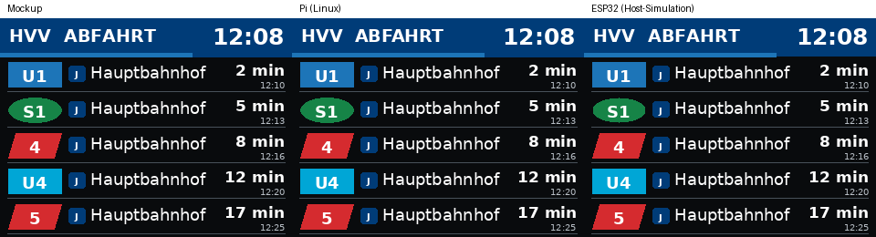
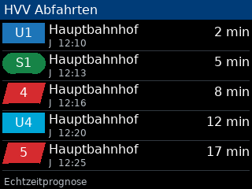
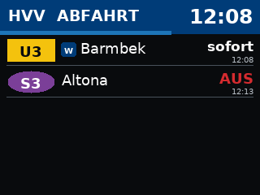
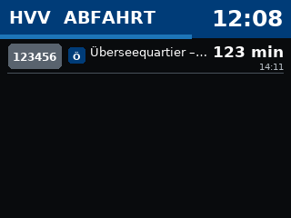

# ESP32-Anzeige: visueller Vergleich mit Pi und Mockup

Referenz: [Issue #123](https://github.com/Ben1991/hvv-anzeiger/issues/123),
[Original-Mockup](hvv-anzeiger-preview.png). Zielauflösung ist 320 × 240 Pixel
im Querformat, insbesondere das CYD-Profil.



Die drei Panels zeigen dieselben fünf Abfahrten, Stationskürzel und die lokale
Uhrzeit 12:08. Die ESP32-Spalte entsteht durch Ausführen von `Board::draw` aus
`esphome/hvv_board.h` als natives C++-Programm. Der Display-Adapter zeichnet die
Operationen auf; Pillow rastert sie mit den gebündelten DejaVu-Schriften und
ESPHome-typischen ganzzahligen Glyphenlaufweiten ohne Kerning. Layoutentscheidungen
werden ausschließlich im Produktionsrenderer getroffen.

## Sichtbare Änderungen

- 42 Pixel hohe blaue Kopfzeile, Akzentstreifen, Titel und lokale Uhr rechts.
- Fünf feste Zeilen zu je 39 Pixeln, auch bei nur einer oder zwei Abfahrten.
- Dieselben Linienfarben, rechteckige U-Bahn-, ovale S-Bahn- und schräge Buslogos.
- Eigenes Stationsbadge, Zieltext mit kleinerer Schrift und UTF-8-sicherer Ellipse.
- Countdown rechts, kleine absolute Zeit darunter; im absoluten Modus keine
  doppelte Zeit. Ausfälle bleiben rot als `AUS` sichtbar.
- Verspätungen sind bereits in der prognostizierten Zeit enthalten. Wie beim Pi
  entfällt eine zusätzliche Verspätungszeile; Pünktlichkeit erzeugt kein `+0 min`.
- Kein dauerhafter gesunder Footer. Verbindungs-/Datenwarnungen bleiben sichtbar;
  fehlende Systemzeit und abgelaufene Daten zeigen keine nutzbaren Abfahrten.

Vorheriger ESP32-Renderer auf derselben Datenbasis:



Weitere tatsächlich ausgeführte Renderfälle:




## Reproduktion

Mit den Projektabhängigkeiten und ESPHome 2026.9.1:

```bash
git clone --depth 1 --branch v7.4.3 https://github.com/bblanchon/ArduinoJson.git /tmp/arduinojson
python tests/firmware/visual_board.py /tmp/arduinojson/src \
  --output /tmp/hvv-visual --check-esphome-fonts
```

Ohne installiertes ESPHome kann `--check-esphome-fonts` entfallen. Der zusätzliche
Check vergleicht Laufweite und oberen Glyphenoffset aller 2.024 konfigurierten
Glyphen direkt mit dem ESPHome-Schriftgenerator. Ergebnis: keine Abweichungen;
102.903 Bytes reine Bitmapdaten. Das ist **keine Messung der fertigen Firmwaregröße**.

Der Test kompiliert den echten C++-Renderer mit `-Wall -Wextra -Werror` und erzeugt
Bilder für Mockup, Verspätung/Ausfall, lange Texte, leere Liste, absolute Zeiten,
veraltete/abgelaufene Daten, fehlende Uhr, ausgeschaltete Anzeige und Nachtmodus.
Er prüft unter anderem Kopfzeilenuhr, Trennlinien, Ausfallkennzeichnung,
UTF-8-Ellipse, Warnungsbanner und vollständig schwarze abgeschaltete Anzeigen.
CI führt ihn aus und lädt die Bilder als `esp32-pi-visual-comparison` hoch.

Mittlere absolute RGB-Abweichung, Skala 0–255, über alle Pixel und Kanäle:

| Referenz / Fall | Abweichung |
| --- | ---: |
| Original-Mockup gegen vorherigen ESP32-Renderer | 53,892 |
| Original-Mockup gegen neuen ESP32-Renderer | 0,219 |
| Linux-Pi-Renderer gegen neuen ESP32-Renderer, fünf Zeilen | 9,517 |
| Linux-Pi, sofort/Ausfall | 3,324 |
| Linux-Pi, leere Liste | 4,494 |
| Linux-Pi, absolute Zeit | 8,353 |

Der Test erzwingt weniger als 1,0 zum Original-Mockup sowie weniger als 12,0 zu den
vier Pi-Fällen. Die Linux-Pi-Abweichung entsteht insbesondere durch dessen
Textlayout mit Kerning; der ESPHome-Renderer setzt einzelne Glyphen mit
Ganzzahlpositionen. [Messwerte als JSON](images/esp32-parity/measurements.json).
Die Vorher-Messung wurde separat mit dem unveränderten Header aus `5966594`
und denselben Daten/Zeichenadapter erzeugt.

## Prüfgrenzen und Abnahme am Gerät

Dies sind Host-Renderings, keine Fotos und keine vollständige LCD-Emulation.
4-Bit-Schrift-Antialiasing, 8-Bit-Displayfarben, SPI-Übertragung, Panelrevision,
OTA-Platz und Heap müssen mit der gebauten Firmware am Gerät geprüft werden.
Farbtiefe und Teilpuffergrößen der Boardprofile wurden nicht geändert.
Bei anderen Auflösungen bleiben feste Zeilen erhalten; die Darstellung ist dort
kein skaliertes 1:1-Abbild des 320×240-Mockups.

Alle fünf Profile wurden mit ESPHome 2026.9.1 validiert. Der lokale CYD-Build wurde
beim Download von `noise-c` durch den Cloud-Proxy mit HTTP 403 blockiert. Daher
liegt hier kein erfolgreicher Geräte-Build und keine Flash-/Hardwareabnahme vor.
Die vorhandene CI kompiliert weiterhin alle fünf Profile.

Die übrige Python-Suite besteht mit 399 Tests und 100 % Branch-/Statement-Coverage,
wenn für die Webtests eine bestätigte Uhr simuliert wird. Ohne diese Simulation
scheitern auf diesem Cloud-Host acht Tests und zwei weitere mit Fehlern; dieselben
Fehler wurden auf dem unveränderten `main` reproduziert. Die Tests prüfen bei
normalem Zeitstatus keine systemd-lose Cloud-Umgebung. Die Uhrprüfung im Produkt
wurde nicht abgeschwächt. Für die lokale Ausführung wurde ausschließlich
`hvv_display.web.time_is_synchronized` außen um `unittest` auf `True` gepatcht;
eigene explizite Uhr-Mocks der Tests behalten Vorrang.
