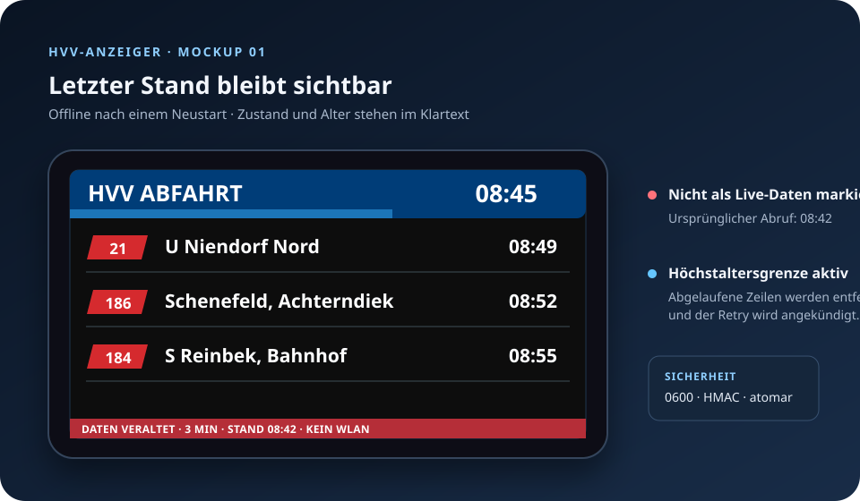
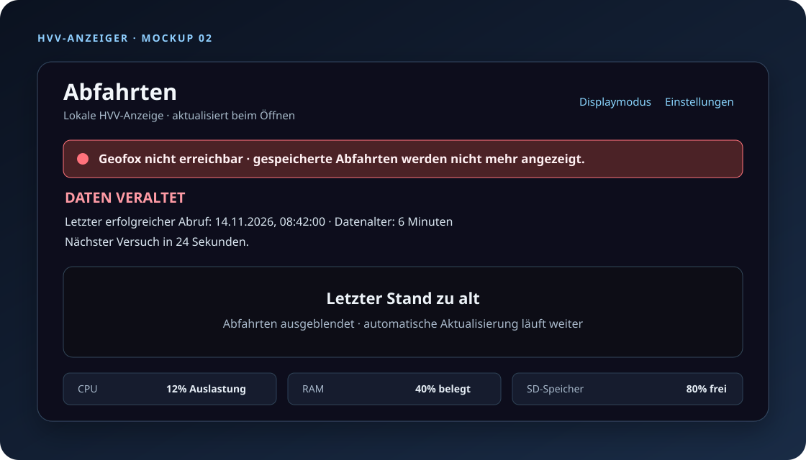

# Issue #56: Offline-Abfahrtscache

## UI-Mockups

Die Mockups zeigen die zwei relevanten Fehlerzustände. Sie dokumentieren die
beschrifteten UI-Zustände; die automatisierten Tests prüfen die Werte der
produktiven Renderer und der Weboberfläche.





## Nachweis je Akzeptanzkriterium

| Kriterium | Nachweis |
|---|---|
| Letzter erfolgreicher Stand bleibt über Neustarts erhalten | `DepartureCacheTest.test_snapshot_survives_a_new_cache_instance_with_private_files`, `MainTest.test_restart_uses_signed_cache_after_geofox_failure_without_extra_request` und `WebApplicationTest.test_web_restart_uses_cache_and_429_retry_without_an_extra_geofox_call` |
| Gleichzeitige Erststarts schreiben einen konsistenten Schlüssel und Snapshot | `DepartureCacheTest.test_concurrent_cache_writers_serialize_key_and_snapshot_publication` und `test_cache_lock_serializes_distinct_service_processes` |
| Höchstalter und sichtbarer Stale-Status | `DepartureCacheTest.test_stale_snapshot_is_shown_only_until_the_configured_age`, `RenderTest.test_status_text_covers_wifi_stale_and_current_states` und `WebApplicationTest.test_expired_web_cache_is_empty_and_shows_next_retry` |
| Kein falscher Live-Zeitpunkt | Cache serialisiert und rendert den unveränderten `fetched_at`-Zeitpunkt; Webtests prüfen den ursprünglichen Abruf und das Datenalter |
| 429 und `Retry-After` bleiben wirksam | Neustart-/Webtests prüfen genau einen Geofox-Aufruf und den nächsten Versuch nach 120 Sekunden; Cache-Lesen selbst ruft Geofox nicht auf |
| Beschädigung, Manipulation, Größe und Dateirechte | `DepartureCacheTest.test_modified_payload_is_rejected_without_crashing`, `test_invalid_and_oversized_cache_files_are_ignored`, `test_cache_symlink_hardlink_and_permissive_file_are_rejected`, `test_invalid_signed_snapshot_fields_are_rejected` und `test_missing_or_invalid_key_rejects_the_snapshot` |
| Frühe Abfahrten und Selbstheilung eines ungültigen Schlüssels | `DepartureCacheTest.test_negative_realtime_delay_survives_cache_round_trip` und `test_missing_or_invalid_key_rejects_the_snapshot` |
| Container verwendet persistenten Cache-Pfad | `ProjectArtifactTest.test_container_departure_cache_uses_persistent_data_volume` und `WebBoundariesTest.test_cli_passes_arguments_to_server` |
| Konfiguration, Migration und Bereinigung | API-Option `api.max_stale_age_minutes` bleibt rückwärtskompatibel; CLI-Pfad ist über `--departure-cache`/`HVV_DEPARTURE_CACHE` konfigurierbar; README beschreibt erstmalige Anlage, Dateirechte, Updateübernahme und Entfernen |
| Linux-Installation | `tests/install-smoke.sh` prüft die ausgelieferten systemd-Units und Installationsabläufe |

## Reproduzierbare Prüfungen

```bash
coverage run -m unittest discover -s tests -v
coverage report
ruff check .
bash -n install.sh update.sh configure-web.sh
bash tests/install-smoke.sh
```

Der Cache speichert ausschließlich gefilterte Abfahrtsobjekte und den letzten
erfolgreichen Abrufzeitpunkt. HMAC-Schlüssel und Snapshot liegen separat unter
`var/` mit Modus `0600`; der Snapshot wird atomar ersetzt. Ein ungültiger
Snapshot wird nicht angezeigt und beim nächsten erfolgreichen Abruf atomar
ersetzt.
